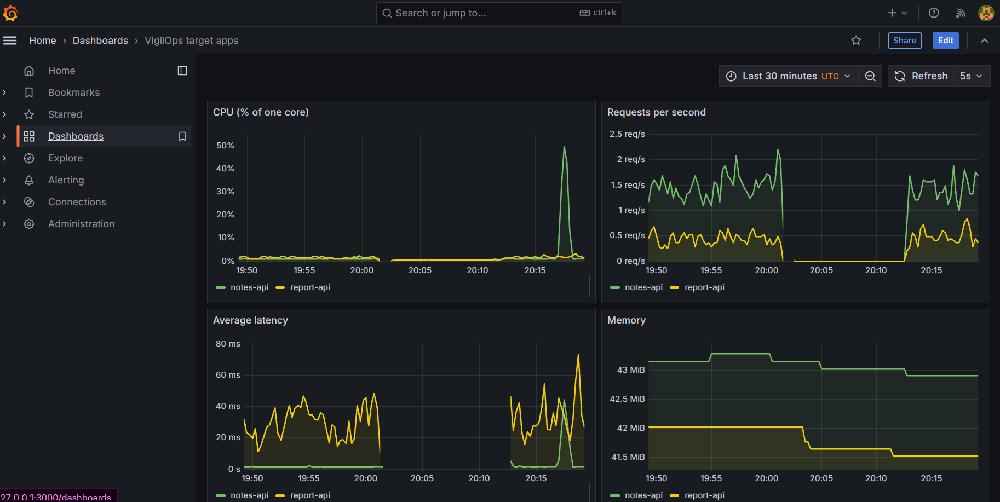

# VigilOps

VigilOps watches two small web apps, learns what "healthy" looks like, and sends an alert when something goes
wrong. It is a student project that combines microservices, machine learning and DevOps: queues, an
autoencoder, a CI/CD pipeline with security scans, Kubernetes, Terraform and Ansible.



The full specification is in [docs/PROJECT.md](docs/PROJECT.md). Every phase has its own note in [docs/](docs/).

## Contents

1. [How it works](#how-it-works)
2. [Results](#results)
3. [Repository map](#repository-map)
4. [Requirements](#requirements)
5. [Quick start with Docker Compose](#quick-start-with-docker-compose)
6. [Run on Kubernetes](#run-on-kubernetes)
7. [Machine learning](#machine-learning)
8. [CI/CD pipeline](#cicd-pipeline)
9. [Cloud deployment (temporary)](#cloud-deployment-temporary)
10. [Documentation index](#documentation-index)
11. [Known limits](#known-limits)
12. [Troubleshooting](#troubleshooting)

## How it works

```
notes-api / report-api          the two apps being watched
        |
    collector  --> [raw-metrics] --> ingestion --> PostgreSQL (metric rates)
                                         |
                                     [rates]
                                         v
                                 anomaly-detection --> [anomalies] --> alerting --> e-mail / log
Prometheus --> Grafana           (dashboard of the two apps)
```

- Messages travel through RabbitMQ queues (shown in square brackets).
- `anomaly-detection` scores a sliding window of recent metrics with an autoencoder. A window the model cannot
  rebuild well is an anomaly. A separate rule catches crashes.
- `alerting` sends one notification per incident and a `[RESOLVED]` message when things are quiet again.
- The detection service runs the model with numpy only (no PyTorch in the container). `ml/check_numpy.py` proves
  that it gives the same scores as the PyTorch model.

## Results

| Check | Result |
|---|---|
| Autoencoder against baseline (final test, F1) | notes-api **0.963** against 0.396, report-api **0.865** against 0.522 |
| Same, on a session recorded after the models were frozen | notes-api **0.902** against 0.364, report-api **0.977** against 0.419 |
| CPU fault injected, time to first alert | 6 s (score 873 against threshold 2.78) |
| Alert cleared after the fault was removed | 2 min 56 s (detection window plus cool-down) |
| Killed pod back to Ready | 9 s, no data lost |
| Commit with a fake secret | pipeline failed at the secret scan in 40 s, nothing was built |
| Retrained model that is worse | rejected by the pipeline gate |

Details, caveats and the small sample sizes are in [docs/evaluation-summary.md](docs/evaluation-summary.md)
and [docs/acceptance-check.md](docs/acceptance-check.md).

## Repository map

| Folder or file | Content | Note |
|---|---|---|
| `services/` | `notes-api`, `report-api`, `collector`, `ingestion`, `anomaly-detection`, `alerting`, one Dockerfile each | phases 1, 3, 5 |
| `ml/` | data preparation, baseline, autoencoder, evaluation, retrain gate, DVC-tracked data, exported models | phases 4, 10 |
| `tools/` | load generator, fault injector, metrics recorder | phase 2 |
| `docker-compose.yml`, `db/` | the whole stack on one machine | phase 3 |
| `k8s/` | Kubernetes manifests, kustomize, Prometheus and Grafana | phase 7 |
| `.gitlab-ci.yml`, `ci/` | the pipeline | phases 6, 8, 10, 11 |
| `infra/` | Terraform (EC2), Ansible (k3s, firewall, node-exporter), kustomize overlay for the cloud server | phase 9 |
| `docs/` | one note per phase, evaluation summary, acceptance check | |

## Requirements

- Windows 11 with WSL2 (Linux also works). Docker Desktop with about 3 GB of RAM for WSL
  (`%UserProfile%\.wslconfig`: `memory=3GB`, `processors=4`).
- Python 3.12, `kubectl`, `kind`, `git`.
- For the cloud part only: Terraform, Ansible (run inside WSL) and an AWS account.
- Everything is sized to fit a laptop with 8 GB of RAM. Close other heavy programs first.

## Quick start with Docker Compose

1. Create your settings file. `.env` is git-ignored and never committed.

   ```
   copy .env.example .env        # Linux or Git Bash: cp .env.example .env
   ```

   Open `.env` and replace every `changeme`. Keep `NOTIFIER=console` to only print alerts in the log, or set
   `NOTIFIER=email` and fill in the SMTP lines (for Gmail, create an app password).

2. Start everything and check it:

   ```
   docker compose up -d --build
   docker compose ps
   ```

3. Send traffic so there is something to measure:

   ```
   python tools/load-generator/load_generator.py --rate 2 --duration 600
   ```

4. Inject a fault. Wait about 2.5 minutes after the traffic starts so the detection window is full.

   ```
   curl -X POST   http://127.0.0.1:8001/faults/cpu     # start a CPU fault on notes-api
   curl -X DELETE http://127.0.0.1:8001/faults/cpu     # remove it
   ```

   With `NOTIFIER=console`, read the alert with `docker compose logs alerting`. The alert appears within about
   10 seconds and the `[RESOLVED]` message about 3 minutes after the fault is removed.

5. Stop everything: `docker compose down`.

Ports: notes-api 8001, report-api 8002. More detail: [docs/phase-3-data-flow.md](docs/phase-3-data-flow.md) and
[docs/running-sessions.md](docs/running-sessions.md).

## Run on Kubernetes

The cluster is a local `kind` cluster named `vigilops`.

1. Create the cluster and the namespace:

   ```
   kind create cluster --config k8s/kind-config.yaml
   kubectl apply -f k8s/bootstrap/namespace.yaml
   ```

2. Create the three secrets by hand. The sealed files in `k8s/secrets/` only open on the cluster that sealed
   them, so a new cluster needs its own.

   ```
   kubectl -n vigilops create secret generic vigilops-secrets --from-env-file=.env
   kubectl -n vigilops create secret docker-registry gitlab-registry --docker-server=registry.gitlab.com --docker-username=<deploy-token-user> --docker-password=<deploy-token>
   kubectl -n vigilops create secret generic grafana-admin --from-literal=admin-password=<choose-a-password>
   ```

3. Deploy. The image names in `k8s/kustomization.yaml` point to this project's GitLab registry. To use your own
   registry, change them and let your own pipeline push the images.

   ```
   kubectl apply -k infra/aws-demo/     # same services, without the sealed secrets from step 2
   kubectl -n vigilops wait --for=condition=Ready pod --all --timeout=600s
   ```

   Use `kubectl apply -k k8s/` instead if you sealed your own secrets for your cluster (see
   [docs/phase-8-automatic-deploy.md](docs/phase-8-automatic-deploy.md)).

4. Open Grafana at http://127.0.0.1:3000 (user `admin`, the password from step 2). The dashboard is called
   "VigilOps target apps". The apps are on http://127.0.0.1:8001 and http://127.0.0.1:8002.

Every workload has CPU and memory limits and liveness and readiness probes. More detail and the lessons learned:
[docs/phase-7-kubernetes.md](docs/phase-7-kubernetes.md).

## Machine learning

The trained models are committed (`ml/models/` for training, `services/anomaly-detection/models/` for the numpy
copy), so you only need this section to retrain or to re-check the results. The training data is tracked with
DVC, and its remote is a folder outside the repository, so you need access to that folder (or your own copy of
the data) for `dvc pull`.

```
cd ml
python -m venv .venv
.venv\Scripts\pip install -r requirements.txt            # Linux: .venv/bin/pip
dvc pull
.venv\Scripts\python prepare_data.py                      # rates and labels from the recorded sessions
.venv\Scripts\python autoencoder.py                       # train, grade against faulty-2..5, export
.venv\Scripts\python holdout.py                           # score the saved models on faulty-7
.venv\Scripts\python export_numpy.py                      # numpy copy for the detection service
.venv\Scripts\python gate.py                              # retrain gate: accepts or rejects a new model
```

Rules used throughout: the split is by time (never random), the threshold comes from healthy data only, and
the autoencoder is always compared with an IsolationForest baseline. Crashes are handled by a rule.
See [docs/phase-4-ml.md](docs/phase-4-ml.md) and [docs/phase-10-mlops-gate.md](docs/phase-10-mlops-gate.md).

## CI/CD pipeline

Push to GitLab and the pipeline runs these stages:

| Stage | What runs | Blocks the pipeline when |
|---|---|---|
| security | Gitleaks (secrets), Semgrep (code), Trivy on dependencies, Checkov on Terraform | a secret, a finding, or a CRITICAL vulnerable library |
| lint, test | ruff and unit tests for each service and for `ml/` | a test fails |
| build, scan | builds and pushes the 6 images, then Trivy scans them | a CRITICAL vulnerability |
| gate | retrains the model when `ml/` changes and compares it with the current one | the new model is worse |
| deploy | applies the manifests to the cluster through a runner on the laptop | a rollout does not become ready |

`checkov-kubernetes` reports problems in the manifests but does not block yet (see Known limits).
How to register the runner and the one CI variable it needs: [docs/phase-8-automatic-deploy.md](docs/phase-8-automatic-deploy.md).
Pipeline design and the proof runs: [docs/phase-6-cicd.md](docs/phase-6-cicd.md),
[docs/phase-11-checkov-and-probes.md](docs/phase-11-checkov-and-probes.md).

GitHub is only a mirror: `git push gitlab main` and `git push github main`.

## Cloud deployment (temporary)

This part is temporary by design. The server was created, checked and destroyed in one session, because the AWS
Learner Lab credentials and budget are temporary. **Nothing runs in AWS now.** The plan, the Ansible run, the
pods and the screenshots are in [docs/phase-9-infrastructure.md](docs/phase-9-infrastructure.md).

To repeat it (this creates billable resources, so read the plan first and destroy when you are done):

```
cd infra/terraform
terraform init
terraform plan                 # read it
terraform apply                # 7 resources
# configure the server with the Ansible playbook, from WSL: see the Phase 9 note
terraform destroy              # do not forget
```

## Documentation index

| Note | Topic |
|---|---|
| [PROJECT.md](docs/PROJECT.md) | the specification |
| [phase-1-foundations.md](docs/phase-1-foundations.md) | the two target apps |
| [phase-2-fault-hooks.md](docs/phase-2-fault-hooks.md), [phase-2-data-prep.md](docs/phase-2-data-prep.md) | fault hooks, recorded sessions, data preparation |
| [running-sessions.md](docs/running-sessions.md) | how to record data |
| [phase-3-data-flow.md](docs/phase-3-data-flow.md) | collector, queues, ingestion, database |
| [phase-4-ml.md](docs/phase-4-ml.md) | models and evaluation |
| [phase-5-detection-and-alerting.md](docs/phase-5-detection-and-alerting.md) | detection service, alerting, live results |
| [phase-6-cicd.md](docs/phase-6-cicd.md) | pipeline and security scans |
| [phase-7-kubernetes.md](docs/phase-7-kubernetes.md) | Kubernetes, monitoring |
| [phase-8-automatic-deploy.md](docs/phase-8-automatic-deploy.md) | runner, sealed secrets, automatic deploy |
| [phase-9-infrastructure.md](docs/phase-9-infrastructure.md) | Terraform, Ansible, cloud server |
| [phase-10-mlops-gate.md](docs/phase-10-mlops-gate.md) | DVC and the retrain gate |
| [phase-11-checkov-and-probes.md](docs/phase-11-checkov-and-probes.md) | Checkov in CI, health probes |
| [evaluation-summary.md](docs/evaluation-summary.md) | baseline against autoencoder |
| [acceptance-check.md](docs/acceptance-check.md) | the final check of the success criteria |

## Known limits

- **Small data.** The model was trained and graded on a few recorded sessions with a handful of injected faults
  per app. Differences of a few points are noise, and the faults are not real incidents.
- **False alarms.** After a cold boot or a long idle period, report-api in particular can raise borderline
  alerts. The thresholds were not tuned to hide this.
- **Kubernetes hardening.** The manifests have no `securityContext` and no NetworkPolicy yet, so
  `checkov-kubernetes` only reports (137 failed checks, 14 kinds repeated over 10 workloads).
- **Laptop dependencies.** The retrain gate and the deploy job need the laptop on, Docker running, and the DVC
  remote folder mounted in the runner. The data remote is one local folder, not a second copy.
- **Monitoring gaps.** node-exporter host metrics are not scraped by Prometheus, and Prometheus keeps 6 hours
  of data in an emptyDir.
- **Not tested by another person.** The rebuild steps above were checked against the repository but have not
  been followed from a clean machine by someone else.

## Troubleshooting

| Symptom | Cause and fix |
|---|---|
| `kubectl get pods` says "No resources found" | The pods live in the `vigilops` namespace: add `-n vigilops`. |
| `Forbidden: unknown` right after starting Docker | The cluster API is still starting. Wait a minute and retry. |
| Pods `0/1` or restarting after a reboot | Normal for about 10 minutes (RabbitMQ and Postgres start slowly). Use the `kubectl wait` command from the Kubernetes section. |
| `ImagePullBackOff` | The `gitlab-registry` secret is missing or wrong, or the image tag does not exist in the registry. |
| Alerts appear with no fault right after traffic starts | Known limit: the first full window after a quiet period can look unusual. Wait 10 minutes. |
| A pipeline touching `ml/` waits forever | The runner is not up: start Docker Desktop and the runner container. |
| Everything is slow or pods are killed | WSL has too little RAM. Check `.wslconfig` and close heavy programs. |
