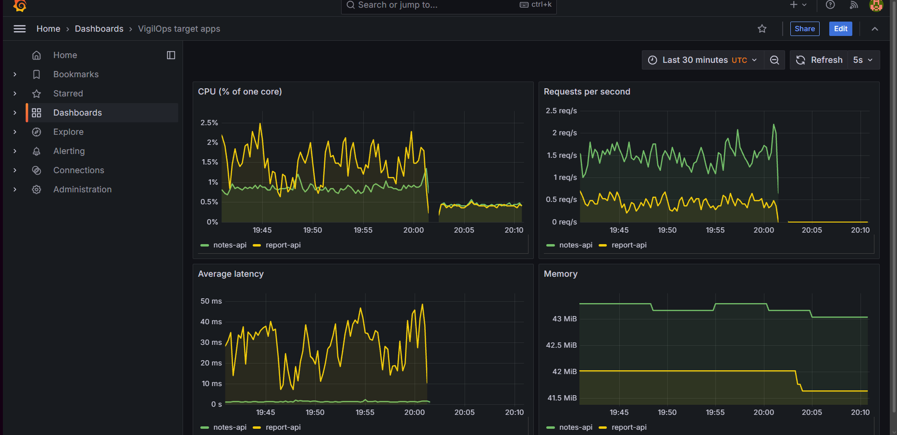
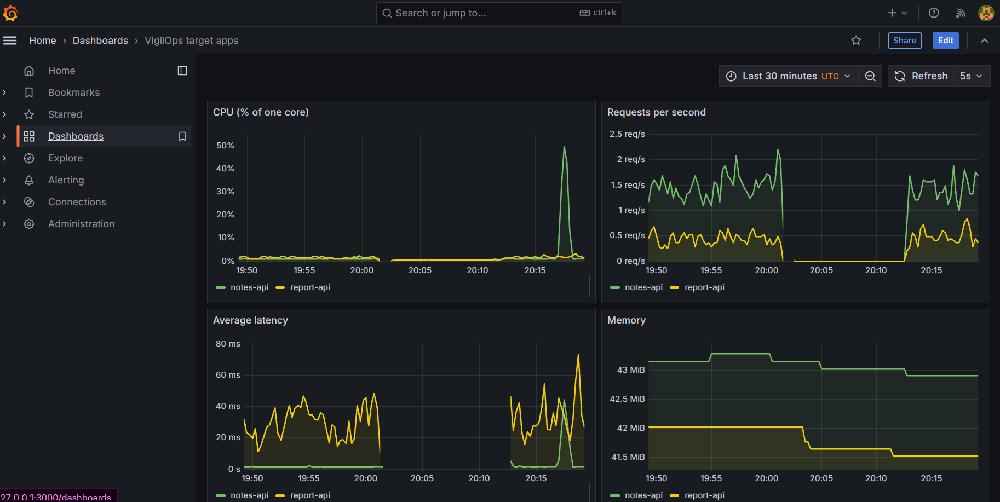

# Phase 7: Kubernetes

## What was built
The whole platform now runs in a local Kubernetes cluster (kind) instead of Docker Compose:
the 2 target apps, the 4 pipeline workers, RabbitMQ, PostgreSQL, and a monitoring stack
(Prometheus + Grafana).

```
kind cluster "vigilops" (1 node, context kind-vigilops), namespace vigilops
 notes-api  report-api            <- targets, NodePort 30002 / 30003 -> host 8001 / 8002
 collector -> rabbitmq -> ingestion -> postgres (PVC)
                  |-> anomaly-detection -> alerting -> email
 prometheus -> scrapes /metrics of both apps -> grafana (NodePort 30001 -> host 3000)
```

| Path in `k8s/` | Content |
|---|---|
| `kind-config.yaml` | the cluster itself: 1 node, 3 NodePort mappings to the host (30001 to 3000, 30002 to 8001, 30003 to 8002). Mappings cannot change on a live cluster. |
| `namespace.yaml`, `configmap.yaml` | the namespace and the non-secret settings (`RABBITMQ_HOST`, `POSTGRES_HOST`, `FAULTS_ENABLED`) |
| `<service>/deployment.yaml` | one folder per service: image, env, probes, requests and limits |
| `notes-api/service.yaml`, `report-api/service.yaml`, `postgres/service.yaml`, `rabbitmq/service.yaml` | stable names inside the cluster (the apps are also NodePort) |
| `postgres/`, `rabbitmq/` | Deployment with `strategy: Recreate` + 1 Gi PVC; Postgres schema from the ConfigMap `postgres-init` |
| `monitoring/prometheus/`, `monitoring/grafana/` | Prometheus (scrape every 5 s, keeps 6 h) and Grafana (datasource and dashboard provisioned from ConfigMaps) |
| `kustomization.yaml` | the entry point **and the one place for image tags** (`images:` block) |
| `secret.yaml.example` | documents the Secret keys; the real Secret is never in git |

## How to run it
```
kind create cluster --config k8s/kind-config.yaml --name vigilops
kubectl create namespace vigilops          # or: kubectl apply -f k8s/namespace.yaml
# 1) registry access (private GitLab registry, read-only deploy token)
kubectl -n vigilops create secret docker-registry gitlab-registry --docker-server=registry.gitlab.com --docker-username=<deploy-token-user> --docker-password=<token>
# 2) app secrets, made from the git-ignored .env
kubectl -n vigilops create secret generic vigilops-secrets --from-env-file=.env
# 3) Grafana admin password
kubectl -n vigilops create secret generic grafana-admin --from-literal=admin-password=<your password>
# 4) everything else
kubectl apply -k k8s/
kubectl -n vigilops get pods
```
The three Secrets are **not** in the kustomization on purpose: a fresh cluster needs them first.
Dashboard: `http://127.0.0.1:3000` (user `admin`), dashboard "VigilOps target apps".
To deploy a new version: edit `newTag` in `kustomization.yaml`, then `kubectl diff -k k8s/` and `kubectl apply -k k8s/`.

## Why it is built this way
- **Deployment, not bare Pod**: a Deployment keeps the declared number of pods alive. Delete one and it is recreated.
- **ConfigMap vs Secret**: non-secret settings live in git (`configmap.yaml`); passwords come from a Secret created by hand. Each worker reads only the keys it needs (`secretKeyRef`, least privilege).
- **Probes**: readiness ("can I get traffic?") and liveness ("am I stuck? restart me"). Collector and ingestion got a small `/health` endpoint in this phase for that (with tests).
- **requests vs limits**: requests are what the scheduler reserves, limits are the ceiling. The two target apps keep the Compose ceiling (500m CPU, 256 Mi).
- **PVC + `Recreate`** for Postgres and RabbitMQ: one pod owns the volume, so the old pod must stop before the new one starts.
- **Kustomize, no Helm**: `kubectl apply -k` applies the whole folder and rewrites image tags in one place.
- **Prometheus vs Grafana**: Prometheus visits `/metrics` and stores the numbers with time stamps; Grafana only draws them. Graphs are for humans, the collector feeds the detector.
- **Private registry**: the node pulls the images (not `kubectl`), so each Deployment names `imagePullSecrets: gitlab-registry` explicitly.

## Live results
Both tests ran on the final node size (WSL raised to 3 GB and 4 CPUs).

### Pod kills (data flow running)
| Test | Result |
|---|---|
| Delete the ingestion pod | new pod Ready after **13 s**; rows in Postgres kept growing (3629 to 3641); the 3 queues back to 1 consumer and 0 backlog |
| Delete the Postgres pod | new pod Ready after **12 s**; 3719 rows before, 3725 right after; **no gap**: samples every 5 s from 20:28:42 to 20:29:37. Ingestion logged "insert failed, reconnecting", then "PostgreSQL not ready, retrying in 3 s" twice, and reconnected at 20:29:13 with **0 restarts**. The message it was holding was not acknowledged, so RabbitMQ delivered it again. |

### Fault to email, inside Kubernetes
| Run | Fault start | First anomaly | ALERT mail | RESOLVED |
|---|---|---|---|---|
| 1 (CPU on notes-api) | 18:49:03 UTC | 18:49:12 (9 s), score 881, 317x above normal | sent 4 s later | 18:52:42 (about 3 min after the fault ended: 2-minute window + 60 s cool-down) |
| 2 (CPU on notes-api) | 20:16:57 UTC | 20:17:07 (10 s), score 928, 334x above normal | sent | after the fault ended |

One ALERT per incident, as designed. Real mails arrived in Gmail.





The empty stretch in the requests panel is a period where no load generator was running. Without
traffic there is nothing to detect (and nothing to draw).

## Honest findings
1. **False alarms after a cold boot.** In the first test (node with 2 GB and 2 CPUs, 15 minutes of
   boot storm, load average 27) the first two ALERT mails were false alarms, 44 s before the fault.
   The real fault then had no mail of its own, because an alert was already open. Later, with no
   fault active, the starved node (CPU 99%, swap in use) made both apps flap. That run is not
   comparable with the model's training conditions. After raising WSL to 3 GB / 4 CPUs the node
   was calm (load about 1).
2. **A short false-alarm episode when traffic starts.** At 18:40:53 (first full window after the load
   generator started) both apps alarmed for about 90 s with no fault, then recovered. This is the
   known "idle, then traffic returns" limit from Phase 5. After the episode the numbers are close
   to the training data (report-api 2.1 % CPU and 34 ms, training 1.3 to 1.7 % and about 25 ms).
3. **report-api flaps.** In the calm minutes 18:43 to 18:47, notes-api had 0 alarms and report-api
   about 10 isolated borderline ones (scores 0.75 to 1.4 against a threshold of 0.66). It has no debounce (k = 1), as chosen in Phase 5,
   and it sends an ALERT/RESOLVED pair of mails each time. Same cause as Phase 5; the rate here is higher than the held-out
   7 false alerts per hour. The model was **not** retuned to hide it (no tuning on test data, since Phase 4).
4. **Resource limits do not explain it.** The apps have the same limits as in Compose and CPU throttling was tiny (67 of 2415 periods).
5. **Alerts said `docker compose logs`.** The message was written for Compose. Fixed with an environment variable `LOG_HINT`
   (default for Compose, overridden in the Kubernetes Deployment) and a test; live check: the alert now says `kubectl -n vigilops logs deploy/<app>`.

## Lessons and bugs
- **`enableServiceLinks: false` on the workers.** Kubernetes injects `RABBITMQ_PORT=tcp://ip:5672` for a Service named `rabbitmq`; our code reads `int(os.getenv("RABBITMQ_PORT"))`, so all 4 workers went into CrashLoopBackOff with a ValueError.
- **RabbitMQ needs `RABBITMQ_NODENAME=rabbit@localhost`.** Its data folder is named after the hostname, and a pod's hostname changes at every restart. Without it the data seems lost.
- **Slow first pulls on a small node.** About 1 min 15 s for our images, and more than 10 minutes for the Grafana and Prometheus images pulled together. The probes of Postgres, RabbitMQ and report-api timed out while several images were pulling.
- **Only commits that change `services/` get new images.** The tag `0291136e` (a commit that only changed `k8s/`) did not exist in the registry; the alerting fix was in `dadf2127`. A failed pull is safe: the old pod keeps serving until the new one is Ready.
- **A fault test needs traffic.** Without a load generator running there is nothing to detect and nothing to draw. Check that requests per second are above 0 before injecting a fault.
- One transient readiness failure at start-up is normal.

## Limits (not hidden)
- **Deploys are manual.** CI builds and pushes images but has no deploy stage: kind is not reachable from the shared runners. Updating means editing `newTag` and `kubectl apply -k`. GitOps tools (Argo CD, Flux) are out of scope.
- **anomaly-detection and alerting have no probes.** They have no health endpoint, so a hang would not be restarted. Fix: add `/health` as in the collector.
- **Postgres and RabbitMQ are only reachable inside the cluster** (ClusterIP). Prometheus stores in an `emptyDir`: graphs are lost if its pod restarts (a PVC would keep them).
- **One node.** kind is a single machine, so there is no real high availability and a node failure takes everything down. The pod-kill tests show self-healing of pods, not of nodes.
- **Secrets are created by hand** (three commands above); a fresh cluster fails until they exist.
- Detection results come from one laptop and small samples (two faults per run), not a benchmark.
